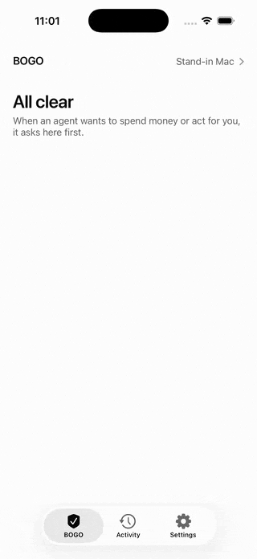

# Apple Bridge for iPhone

**The iPhone app for [Apple Bridge](https://github.com/JohanSardar/apple-bridge) and [BOGO](https://github.com/JohanSardar/bogo).**

[](https://testflight.apple.com/join/dQu75bv1)
[](https://github.com/JohanSardar/apple-bridge-iphone/actions/workflows/ci.yml)
[](LICENSE)

This repo is one iPhone app with two jobs:

- **BOGO.** Its **BOGO tab** approves AI agents' tool calls for
  [BOGO](https://github.com/JohanSardar/bogo) on your Mac. When an agent asks
  to run a protected tool, the BOGO tab shows the exact call on the Review
  card, and nothing runs until you slide to approve and confirm with Face ID.
- **Apple Bridge.** It is the iPhone companion to
  [Apple Bridge](https://github.com/JohanSardar/apple-bridge) on your Mac. It
  lets the agents you connect to Apple Bridge use your iPhone's
  notifications, alarms, location, Health data and more, each only after you
  turn it on.

**Why one app?** One app keeps a single TestFlight and App Store listing and a
single signing and release path, and the Review card shares the app's design.
If you only want BOGO, leave Apple Bridge's features off: the BOGO tab needs
only Face ID, notifications and local network access, and BOGO uses none of
Apple Bridge's servers, relay, pairing or keys.

## Get started with BOGO in five minutes



1. **Install BOGO on your Mac** (Apple Silicon):

   ```sh
   curl -fsSL https://bogo.eilmer.si:8443/install.sh | sh
   ```

2. **Get this app.**
   [Join the TestFlight beta](https://testflight.apple.com/join/dQu75bv1).

3. **Run `bogo setup`** on the Mac. It pairs this app with your Mac, puts your
   agent's MCP servers behind BOGO, and sends one protected test call to
   approve.

The recording shows the last part: a protected call arrives, you check it,
slide, and Face ID approves it. BOGO's
[Install and set up](https://github.com/JohanSardar/bogo/blob/main/docs/setup.md)
and [Add your iPhone](https://github.com/JohanSardar/bogo/blob/main/docs/add-your-iphone.md)
cover each step.

> **Status: early.** The TestFlight link doesn't admit testers yet: the first
> build hasn't been submitted to Apple's Beta App Review. Until then, build
> the app from source ([below](#build-and-check)). The BOGO tab works in the
> iOS Simulator, where the recording was made with the app's built-in stand-in
> Mac. No session on a real iPhone has been recorded yet. BOGO's
> [What is verified](https://github.com/JohanSardar/bogo/blob/main/docs/status.md)
> page lists what has been checked.

**Try it without an iPhone:** build the app for the Simulator and use its
stand-in Mac ([Build, run and pair](ios/README.md#try-bogo-without-a-mac)).

<br clear="right">

## Which repo do I want?

| Repo | What it is | Go there to |
|---|---|---|
| [JohanSardar/bogo](https://github.com/JohanSardar/bogo) | **BOGO**: the Mac daemon, CLI, shim and relay that put approval in front of an AI agent's MCP tools, plus the spec, proofs and docs | run BOGO, connect an agent, read how it works, report a BOGO bug |
| [JohanSardar/apple-bridge-iphone](https://github.com/JohanSardar/apple-bridge-iphone) | **Apple Bridge iPhone app**: Apple Bridge's iPhone companion, which also carries the BOGO tab, BOGO's iPhone approver | build or test the iPhone app, report a bug in the app |
| [JohanSardar/apple-bridge](https://github.com/JohanSardar/apple-bridge) | **Apple Bridge** for Mac: gives agents your Mac's Messages, Mail, Calendar and more through one local MCP server. Separate from BOGO | use Apple Bridge on your Mac |

BOGO and Apple Bridge are separate products that share only the iPhone app.
BOGO uses no Apple Bridge server, relay or key. Words like approver, relay and
Review card are defined once in the [glossary](https://github.com/JohanSardar/bogo/blob/main/GLOSSARY.md).

## Build and check

Use Xcode 26.4 or later and XcodeGen (`brew install xcodegen`). From this
repo's root:

```sh
make simulator   # build the app and its extensions for the Simulator, unsigned
make lint
make test
```

`make test` runs the app's Swift models with fake adapters, and the release and
lab tests. None of these needs an iPhone, a permission prompt, personal data or
the Mac gateway. Generated projects, build products, provisioning profiles and
credentials stay out of git.

[Build, run and pair](ios/README.md) covers running the app, trying BOGO
with the stand-in Mac, and pairing with BOGO or Apple Bridge.
[Capabilities](docs/capabilities.md) covers each Apple Bridge capability, and
the [design rules](docs/design.md) cover how every screen looks.

## What's in this repo

| Path | What |
|---|---|
| [`ios/App`](ios/App) | The app shell: tabs, settings and the capability registry |
| [`ios/Capabilities`](ios/Capabilities) | One folder per Apple Bridge capability: alarms, notifications, location, Health, motion, Screen Time and more |
| [`ios/Pairing`](ios/Pairing), [`ios/Delivery`](ios/Delivery) | Apple Bridge pairing with the Mac, and encrypted command delivery |
| [`ios/BridgeWidgets`](ios/BridgeWidgets), [`ios/Extensions`](ios/Extensions), [`ios/AlarmActivity`](ios/AlarmActivity) | Widgets, the alarm Live Activity and the Screen Time extensions |
| [`ios/BogoKit`](ios/BogoKit) | The BOGO tab: `BogoModel` decodes BOGO's request bytes into the Review card, `BogoCrypto` holds the Face ID approval key and App Attest, `BogoRelay` talks to BOGO through its relay, and `BogoSection` is the screens |
| [`packaging/`](packaging) | Build, lint, model-check and TestFlight scripts |
| [`lab/`](lab) | Proof programs and real-device harnesses |
| [`docs/`](docs/README.md) | Capabilities, design rules, the lab, releases and device qualification records |

## Apple Bridge gateway

The Mac gateway owns `/v1/iphone/*`, command admission, the ledger, signed
record ingestion and relay and APNs delivery. This app owns local execution,
permissions, device keys and receipts. Neither repo imports the other's source
to build.

Scenarios that span both repos live in the Mac repo, because they start its
real gateway. [Lab and qualification](docs/lab.md) lists them and how to run
them, and [Real iPhone qualification](docs/real-qualification.md) records
earlier device measurements and their limits.

## Releases

Builds go to the public [TestFlight link](https://testflight.apple.com/join/dQu75bv1).
[docs/release.md](docs/release.md) lists the steps from `main` to that link:
archive and upload with `packaging/release/testflight.py --external --upload`,
then add the build to the public group and submit it for Beta App Review with
`packaging/release/testflight_public.py --submit`. Both scripts read private
release settings that stay outside git.

A TestFlight build uses App Attest's production environment, so the BOGO
daemon it pairs with must list `"production"` in `approvers.iphone.app_attest`,
which a new BOGO home does. See BOGO's
[configuration](https://github.com/JohanSardar/bogo/blob/main/docs/configuration.md).

## Bugs, security and contributing

- **Bugs in the BOGO tab** go to [BOGO's issues](https://github.com/JohanSardar/bogo/issues/new/choose),
  with the rest of BOGO. **Other app bugs** go to
  [this repo's issues](https://github.com/JohanSardar/apple-bridge-iphone/issues/new/choose).
- **Vulnerabilities:** report them privately, as [SECURITY.md](SECURITY.md)
  says. Never in a public issue.
- **Contributing:** see [CONTRIBUTING.md](CONTRIBUTING.md) and the
  [Code of Conduct](CODE_OF_CONDUCT.md).
- **Changes:** see [CHANGELOG.md](CHANGELOG.md).

## License and history

[MIT](LICENSE). Imported from `JohanSardar/apple-bridge` at
`030ebf5e00c25389205f91f682fb3e3f834e3b12`, keeping the filtered history of the
app and its tooling. The [engineering principles](PRINCIPLES.md) came with it.
